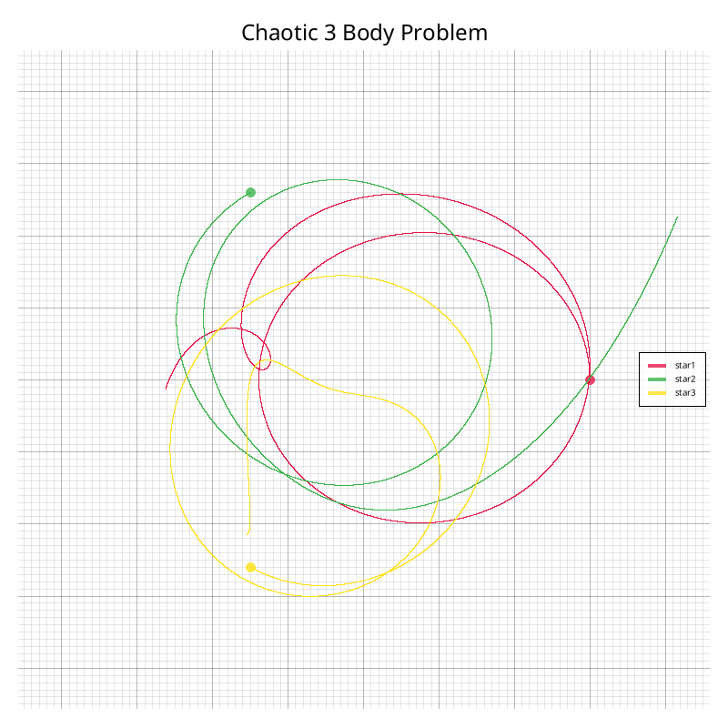
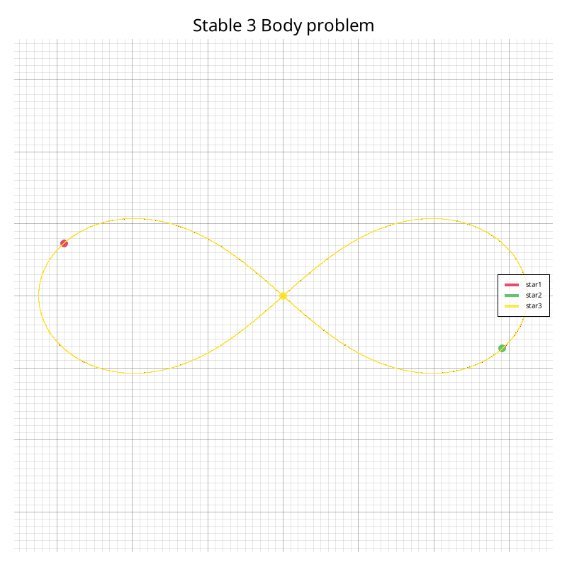
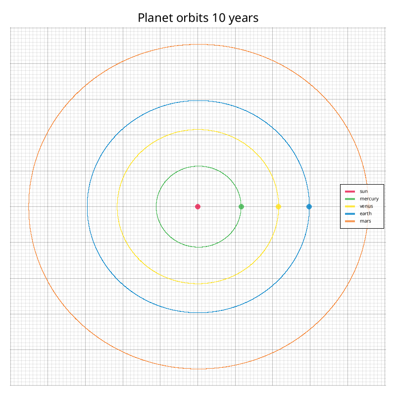
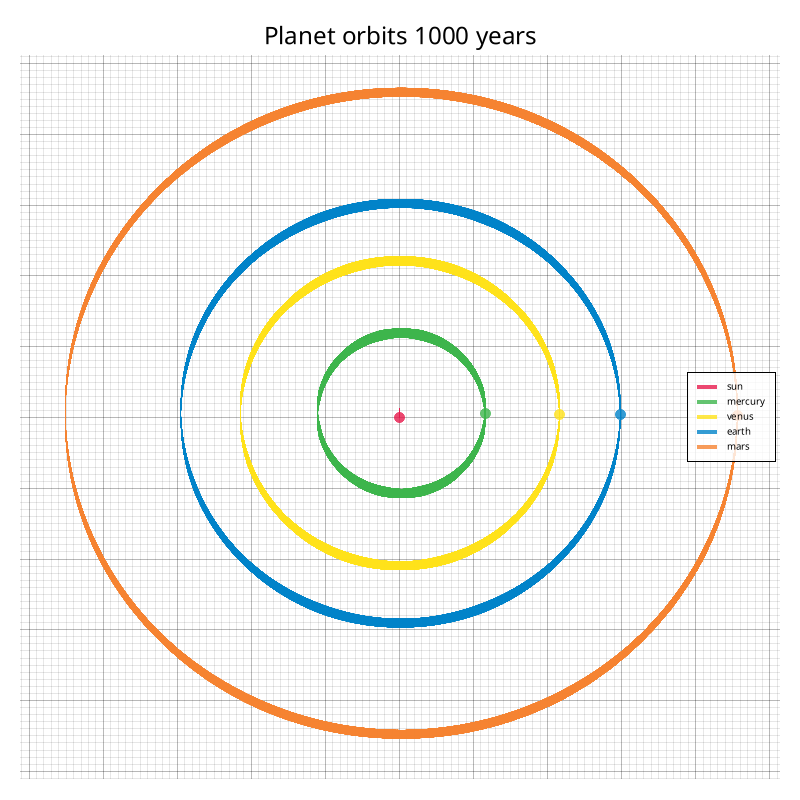

# Planets

A small 2D N-body orbital simulator written in Rust. It calculates gravitational interactions between celestial bodies using 4th-order Runge-Kutta (RK4) integration and plots the resulting trajectories to an image.

## How It Works

- **Physics & Units:** Positions, velocities, forces, and accelerations are typed with [`euclid`](https://crates.io/crates/euclid) unit tags (`WorldM`, `WorldV`, `WorldF`, `WorldA`) so vectors of different physical quantities don't get mixed up.
- **Integration:** At each time step, every body computes the net gravitational pull from all other bodies in the system and updates its position and velocity via RK4.
- **Plotting:** After the simulation finishes, [`plotters`](https://crates.io/crates/plotters) renders the orbital paths to `data/`.

## Tweaking the Simulation

Everything is configured in `src/main.rs` inside `main()`:
- Add your own celestial bodies with position in units of meters and velocity in meter/second and then add them to the `bodies` vector.
- Or use the premade celestial bodies like the planets, sun or the 3 stars.
- Adjust `run_time` and `steps` to change the simulation duration and time-step precision.
- Modify the file name and the title of the simulation.

## Running

Make sure the directory exists for the output image, then run:

```bash
cargo run --release
```

## Demos
The circles show the initial position of the objects





Runs in 1.575 seconds
At first glance, the thick bands at the top and bottom might look like numerical energy loss or inaccuracy.
However, closer analysis showed this is actually conservation of momentum in action, because all the planets start with an upward (+y) velocity while the Sun starts at rest, the entire Solar System's center of mass slowly drifts upward over the 1,000-year run. 
You can see the Sun's upward path in the center, while the left and right edges of each orbit remain razor-thin—confirming orbital energy is conserved.
